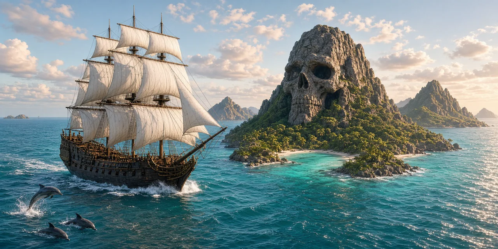

# pirate-ship

Skull Island Cove — a sailable Three.js (WebGPU) ocean scene: Dutch sailing ship, skull volcano island, archipelago, marine life. Steer with WASD/arrow keys or a gamepad; drag to orbit, scroll to zoom.

Live: https://jollyroger1480.github.io/pirate-ship/

Free to use. If it saved you time, tips are welcome: [Cash App](https://cash.app/$jollyroger1480) or Bitcoin `bc1qydycnf5pjhez5d0mrgmmumyv2g5nc63mwet89j`. More links at the [bottom](#support-and-links).

## Support and links

This project is free, and a tip is welcome but never expected.

- Tip (Cash App): [$jollyroger1480](https://cash.app/$jollyroger1480)
- Bitcoin: `bc1qydycnf5pjhez5d0mrgmmumyv2g5nc63mwet89j`
- eBay store: [Buccaneer Salvage](https://www.ebay.com/str/buccaneersalvage)
- YouTube: [@BuccaneerSalvage](https://www.youtube.com/@BuccaneerSalvage)
- X: [@jollyroger1480](https://x.com/jollyroger1480)
